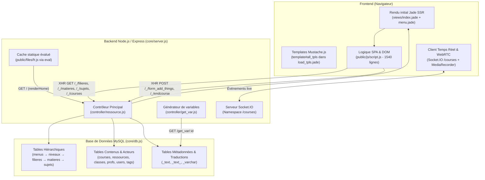
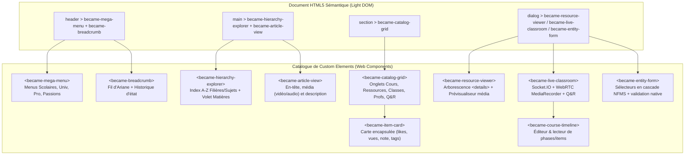

# État des Lieux Approfondi & Plan de Migration HTML5 / Web Components — Projet **BECAME**

## 1. Vue d'ensemble et Architecture Actuelle

**BECAME** (*became.net*) est une plateforme LMS (Learning Management System) et MOOC social multilingue initiée en octobre 2017 ([package.json](file:///home/nihongo/Bureau/became_PROJECT/package.json#L1-L23)). Son objectif est d'organiser l'apprentissage selon 4 grands domaines (**Scolaires**, **Universitaires**, **Professionnels**, **Passions**) à travers une navigation hiérarchique à 5 niveaux et des salles de cours interactives en temps réel.



### Stack Technique Actuelle
* **Serveur** : [app.js](file:///home/nihongo/Bureau/became_PROJECT/app.js) charge [core/server.js](file:///home/nihongo/Bureau/became_PROJECT/core/server.js) (Express 4, `express-session`, `passport` non configuré, `multiparty` pour l'upload, `socket.io` sur le port `8081` défini dans [core/settings.js](file:///home/nihongo/Bureau/became_PROJECT/core/settings.js)).
* **Accès aux données** : [core/db.js](file:///home/nihongo/Bureau/became_PROJECT/core/db.js) encapsule le driver `mysql` avec [`executeSql`](file:///home/nihongo/Bureau/became_PROJECT/core/db.js#L6-L27) et une fausse transaction séquentielle récursive [`executeTransaction`](file:///home/nihongo/Bureau/became_PROJECT/core/db.js#L50-L86) qui ouvre une nouvelle connexion sans la fermer.
* **Rendu Hybride (SSR + CSR)** :
  * Au chargement initial (`GET /`), [`renderHome`](file:///home/nihongo/Bureau/became_PROJECT/controller/ressource.js#L21-L41) **ne requête pas MySQL** : il lit [public/files/fr.js](file:///home/nihongo/Bureau/became_PROJECT/public/files/fr.js) avec `fs.readFileSync` et exécute `eval(file)` pour injecter `accueil`, `menus`, `start`, `b_translates`, `b_params`, `world_pays` dans [views/index.jade](file:///home/nihongo/Bureau/became_PROJECT/views/index.jade).
  * Côté client, [views/load.jade](file:///home/nihongo/Bureau/became_PROJECT/views/load.jade#L24-L25) embarque une balise `<template id="all_tpls">` contenant [views/load_tpls.jade](file:///home/nihongo/Bureau/became_PROJECT/views/load_tpls.jade). Au démarrage, [`start_defaut_behavior`](file:///home/nihongo/Bureau/became_PROJECT/public/js/script.js#L545-L596) découpe ce `<template>` en sous-templates Mustache.js attachés directement comme propriétés sur les éléments DOM (`$main_output[0].course_tpl`, `$section[0].courses_tpl_prof`, etc.).
* **Pollution CSS / JS** : La page charge simultanément **3 frameworks CSS** concurrents (**Semantic UI**, **Materialize CSS**, **W3.CSS**) dans [views/load.jade](file:///home/nihongo/Bureau/became_PROJECT/views/load.jade#L1-L15), ainsi que des fichiers JS hérités d'anciens projets sans rapport avec le LMS ([public/js/script_.js](file:///home/nihongo/Bureau/became_PROJECT/public/js/script_.js) qui gère une carte de diocèses/régions et un compteur `iwai`, [public/js/_script.js](file:///home/nihongo/Bureau/became_PROJECT/public/js/_script.js), et [public/js/ad-min.js](file:///home/nihongo/Bureau/became_PROJECT/public/js/ad-min.js)).
* **Prototype de référence** : Le dossier [modeling/index.html](file:///home/nihongo/Bureau/became_PROJECT/modeling/index.html) contient la maquette statique originale ("Global MOOC"), très précieuse car elle révèle la liste complète des sous-menus prévus pour `Universitaires` (BTS, IUT, Prépas, Licence, Master, Doctorat), `Professionnels` (31 secteurs d'activité) et `Passions` (Bricolage, Cuisine, Jeux, Langues, Musique, Sport...).

---

## 2. Diagnostic Complet du Schéma et des Données SQL (Pourquoi l'application bloque à ~50%)

Les fichiers [became_createDB.sql](file:///home/nihongo/Bureau/became_PROJECT/became_createDB.sql), [became_features.sql](file:///home/nihongo/Bureau/became_PROJECT/became_features.sql) et [became_features2.sql](file:///home/nihongo/Bureau/became_PROJECT/became_features2.sql) ont été reconstruits partiellement sans croiser simultanément [controller/ressource.js](file:///home/nihongo/Bureau/became_PROJECT/controller/ressource.js), [controller/get_var.js](file:///home/nihongo/Bureau/became_PROJECT/controller/get_var.js), [public/files/fr.js](file:///home/nihongo/Bureau/became_PROJECT/public/files/fr.js) et [public/js/script.js](file:///home/nihongo/Bureau/became_PROJECT/public/js/script.js). Voici **toutes les causes exactes** des blocages SQL et JS :

> [!IMPORTANT]
> **Découverte clé : [public/files/fr.js](file:///home/nihongo/Bureau/became_PROJECT/public/files/fr.js) et [controller/get_var.js](file:///home/nihongo/Bureau/became_PROJECT/controller/get_var.js) contiennent l'empreinte exacte de la base de données d'origine.**
> Le fichier [public/files/fr.js](file:///home/nihongo/Bureau/became_PROJECT/public/files/fr.js) est en réalité une sauvegarde statique des résultats des requêtes SQL de [controller/get_var.js](file:///home/nihongo/Bureau/became_PROJECT/controller/get_var.js) ! Il impose les identifiants exacts que la base MySQL doit posséder pour répondre aux clics du menu.

### 2.1. Le piège de la bifurcation Collège / Lycée (`data-bool="false"`)
Dans [public/files/fr.js](file:///home/nihongo/Bureau/became_PROJECT/public/files/fr.js#L2), le menu `Scolaires` (`id_menus = 1`) possède **8 niveaux** (`sousmenu`) :
* `id_niveaux: 8` (*Pre-collège*), `1` (*6ème*), `2` (*5ème*), `3` (*4ème*), `4` (*3ème*)
* `id_niveaux: 5` (*2de*), `6` (*1ere*), `7` (*Terminal*)

Or, dans [views/menu.jade](file:///home/nihongo/Bureau/became_PROJECT/views/menu.jade#L14-L15) :
```jade
- if(j.fk==1 && ii<val.sousmenu.length-3)
    - j.lien["data-bool"]="false"
```
Et dans [public/js/script.js](file:///home/nihongo/Bureau/became_PROJECT/public/js/script.js#L79-L85) :
* Pour les **5 premiers niveaux** (Pré-collège à 3ème, où `data-bool="false"` existe), le clic **saute l'étape des filières** (`$main_section`) et appelle directement `/_/matieres/<id>` ! Cela signifie que dans la table `matieres`, `fk` pointe vers `id_filieres`, et qu'il doit exister des filières implicites `1, 2, 3, 4, 8` correspondant directement à ces classes de collège.
* Pour les **3 derniers niveaux** (2de, 1ère, Terminale, `id_niveaux = 5, 6, 7`, sans `data-bool`), le clic appelle `/_/filieres/<id_niveaux>` (`WHERE filieres.fk IN (5, 6, 7)`), affiche l'index alphabétique des filières (Scientifique, Littéraire, etc.), puis le clic sur une filière appelle `/_/matieres/<id_filieres>`.
* Dans [became_features2.sql](file:///home/nihongo/Bureau/became_PROJECT/became_features2.sql#L1-L15), `niveaux` a été peuplé avec `1 = college, 2 = lycee`, ce qui entre en collision frontale avec les `data-data="1..8"` générés par [public/files/fr.js](file:///home/nihongo/Bureau/became_PROJECT/public/files/fr.js) dans le menu !

### 2.2. Tables et Colonnes Manquantes ou Erronées dans [became_createDB.sql](file:///home/nihongo/Bureau/became_PROJECT/became_createDB.sql)

| Élément SQL | État dans `became_createDB.sql` | Ce qu'exige réellement le code | Référence Code |
| :--- | :--- | :--- | :--- |
| Table `menus` | **Absente** | `CREATE TABLE menus (id_menus INT PRIMARY KEY AUTO_INCREMENT, ...)` | [`get_var.menus`](file:///home/nihongo/Bureau/became_PROJECT/controller/get_var.js#L31) |
| Colonne `niveaux.fk` | **Absente** | `fk INT` référençant `menus(id_menus)` (`1`=Scolaires, `2`=Univ, `3`=Pro, `4`=Passions) | [`get_var.menus`](file:///home/nihongo/Bureau/became_PROJECT/controller/get_var.js#L35), [`form_add_things`](file:///home/nihongo/Bureau/became_PROJECT/controller/ressource.js#L200) |
| Colonne `courses.tl_` | **Absente** | `tl_ LONGTEXT` pour enregistrer la timeline finale + événements live en fin de cours | [`rsc.endcourse`](file:///home/nihongo/Bureau/became_PROJECT/controller/ressource.js#L164) |
| Colonne `_text_.id` | `id INT` | `id VARCHAR(255)` car utilisé avec `id=""` (`start`, `accueil`) et avec des IDs numériques | [`get_var.start`](file:///home/nihongo/Bureau/became_PROJECT/controller/get_var.js#L6), [`get_var.accueil`](file:///home/nihongo/Bureau/became_PROJECT/controller/get_var.js#L18) |
| Colonnes langues (`de`, `jp`, `cn`, `ar`) | Seuls `fr, en, es` existent | Le formulaire d'ajout propose 7 langues (`fr, en, es, de, jp, cn, ar`) | [public/files/fr.js](file:///home/nihongo/Bureau/became_PROJECT/public/files/fr.js#L7), [`form_add_things`](file:///home/nihongo/Bureau/became_PROJECT/controller/ressource.js#L207) |

### 2.3. Structures JSON Strictes Attendues dans les Colonnes SQL
Plusieurs colonnes `TEXT` ou `JSON` sont parsées sans `try/catch` par `JSON.parse()` côté client ([public/js/script.js](file:///home/nihongo/Bureau/became_PROJECT/public/js/script.js)). Si le format diffère d'un seul caractère ou d'une seule clé, l'exécution JS plante :

1. **Table `_text` (`username = 'article'`, `id = '<type>_<fk>'`)** :
   * Utilisée par [`_0`](file:///home/nihongo/Bureau/became_PROJECT/public/js/script.js#L1217), [`_1`](file:///home/nihongo/Bureau/became_PROJECT/public/js/script.js#L1281), [`_2`](file:///home/nihongo/Bureau/became_PROJECT/public/js/script.js#L1351), [`_3`](file:///home/nihongo/Bureau/became_PROJECT/public/js/script.js#L1428) via [`fonction_qui_traite_la_reponse_xhr_pour_l_article_principal`](file:///home/nihongo/Bureau/became_PROJECT/public/js/script.js#L1194-L1213).
   * **Cause du crash dans `became_features2.sql`** : Le script insère du texte brut (`'Le collège est...'`) au lieu d'un objet JSON structuré.
   * **Structure JSON obligatoire** :
     ```json
     {
       "header": {
         "h": "Titre de l'article",
         "img": { "src": "/imgs/select_void.png", "alt": "Alt", "title": "Titre image" }
       },
       "main": {
         "video": "", "audio": "", "lvideo": "", "laudio": "",
         "p": "<p>Description HTML complète de la section...</p>"
       },
       "footer": { "template": "" }
     }
     ```
2. **Table `_text_` (`username IN ('niveaux', 'filieres', 'matieres', 'sujets')`, `id = '<id_entite>'`)** :
   * **Structure JSON obligatoire** :
     ```json
     {
       "href": "mathematiques-6eme",
       "html": "Mathématiques",
       "title": "Cours de Mathématiques 6ème",
       "img": { "src": "/imgs/select_void.png", "alt": "Maths", "title": "Maths" }
     }
     ```
3. **Table `_varchar` (Les 3 discriminants `username` requis par les `INNER JOIN`)** :
   * `username = 'cl_type'` : requis par [`rsc.matieres`](file:///home/nihongo/Bureau/became_PROJECT/controller/ressource.js#L61) pour les classes.
   * `username = 'c_type'` : requis par [`rsc.courses`](file:///home/nihongo/Bureau/became_PROJECT/controller/ressource.js#L93) pour les cours (**absent** de `became_features.sql` et `became_features2.sql`, ce qui empêche tout cours de s'afficher !).
   * `username = 'r_type'` : requis par [`rsc.courses`](file:///home/nihongo/Bureau/became_PROJECT/controller/ressource.js#L94) pour les ressources (**absent** des deux fichiers SQL, ce qui empêche toute ressource de s'afficher !).
4. **Tables `courses` et `ressources` (Colonnes `likes`, `views`, `note`, `coms`)** :
   * Dans [`_3`](file:///home/nihongo/Bureau/became_PROJECT/public/js/script.js#L1442-L1480), le code exécute `.length` et `.forEach()` sur `JSON.parse(i.likes)`, `JSON.parse(i.views)`, `JSON.parse(i.coms)`, `JSON.parse(i.note)`.
   * **Cause du crash dans `became_features.sql` et `became_features2.sql`** : `became_features.sql` met des objets `{"count": 50}` (`forEach` plante sur un objet !) et `became_features2.sql` laisse `NULL` (`JSON.parse(null)` retourne `null`, `.length` plante !).
   * **Format obligatoire** : Des tableaux JSON valides, ex. `likes = '[1, 2]'`, `views = '["2026-10-01", "2026-11-01"]'`, `note = '[4, 5]'`, `coms = '[]'`.
5. **Colonne `ressources.json` et fichiers physiques dans [public/files/ressources/_1/](file:///home/nihongo/Bureau/became_PROJECT/public/files/ressources/_1/ok.pdf)** :
   * [`extract_ressource_from_json`](file:///home/nihongo/Bureau/became_PROJECT/public/js/script.js#L696-L717) parcourt récursivement les clés commençant par `dir_` et `file_`. Pour correspondre aux fichiers réellement présents dans `/public/files/ressources/_1/`, `ressources.json` pour `id_ressources = 1` doit avoir la forme :
     ```json
     {
       "file_1": { "href": "instrucenofvntions.html", "title": "Instructions", "type": "html", "html": "Instructions du cours" },
       "file_2": { "href": "ok.pdf", "title": "Support PDF", "type": "pdf", "html": "Support PDF" },
       "dir_1": {
         "dirname": "Annexes",
         "dir_id": "annexes_1",
         "file_3": { "href": "iufnuonjesuisune-image-yo-ne!.png", "title": "Schéma", "type": "img", "html": "Image explicative" }
       }
     }
     ```
6. **Colonne `courses.tl` (Timeline du cours)** :
   * [`get_tl`](file:///home/nihongo/Bureau/became_PROJECT/public/js/script.js#L718-L768) et [`run_tl`](file:///home/nihongo/Bureau/became_PROJECT/public/js/script.js#L769-L902) attendent un objet JSON contenant deux tableaux `phases` et `items` (avec des horaires `MM:SS` inférieurs à `duree`) :
     ```json
     {
       "phases": [
         { "start": "00:00", "end": "30:00", "title": "1. Introduction" },
         { "start": "30:00", "end": "60:00", "title": "2. Exercices d'application" }
       ],
       "items": [
         { "id_phase": "_0", "href": "/ressources/_1/ok.pdf", "type": "pdf", "title": "Support PDF", "time": "05:00" }
       ],
       "live": []
     }
     ```

### 2.4. Bugs dans les Requêtes SQL et le Code JS Actuel

> [!WARNING]
> Même avec des données SQL parfaites, **3 bugs dans le code actuel** bloquent la moitié du parcours :

1. **`ONLY_FULL_GROUP_BY` dans [`rsc.courses`](file:///home/nihongo/Bureau/became_PROJECT/controller/ressource.js#L93)** :
   La requête SQL des cours (`sql[1]`) utilise `group_concat(concat(id_tags, "_", tags.fr) separator "||") as tags` **sans clause `GROUP BY id_courses`** à la fin (contrairement à `sql[2]` pour les ressources à la ligne 94 et `sql[2]` pour les classes à la ligne 61). Sur tout serveur MySQL moderne où `ONLY_FULL_GROUP_BY` est actif, cliquer sur un sujet fait crasher le serveur Node (`if (err) throw err`).
2. **Typo `ressources_ids` vs `ressource_ids` dans [`_3`](file:///home/nihongo/Bureau/became_PROJECT/public/js/script.js#L1451)** :
   À la ligne 1451 de `public/js/script.js`, l'objet `tmp` est construit avec `ids: i.ressources_ids` (avec un `s`), alors que la colonne SQL s'appelle `ressource_ids` (sans `s`). Heureusement, à la ligne 301, le code lit `tmp[0].obj_.ressource_ids` qui fonctionne si `ressource_ids` est renseigné.
3. **Jointures CSV avec `IN (...)` ([controller/ressource.js](file:///home/nihongo/Bureau/became_PROJECT/controller/ressource.js#L61-L94))** :
   En SQL, écrire `WHERE id_tags IN (c.tag_ids)` quand `c.tag_ids` vaut `'1,2'` équivaut à `id_tags IN ('1,2')` (une seule chaîne), que MySQL convertit silencieusement en l'entier `1` en ignorant `2`. Pour joindre correctement une liste CSV en MySQL sans table de jointure, il faut utiliser `FIND_IN_SET(id_tags, c.tag_ids)`.

---

## 3. État d'Avancement Fonctionnel Global du Projet

| Module / Fonctionnalité | État Actuel | Détails Techniques |
| :--- | :---: | :--- |
| **Menu principal & Sous-menus (`Scolaires`)** | 🟢 **90%** | Fonctionnel via [public/files/fr.js](file:///home/nihongo/Bureau/became_PROJECT/public/files/fr.js). Les 3 autres menus (`Universitaires`, `Professionnels`, `Passions`) ont `sousmenu: []` dans `fr.js` (mais leurs sous-menus existent dans [modeling/index.html](file:///home/nihongo/Bureau/became_PROJECT/modeling/index.html#L68-L158)). |
| **Navigation hiérarchique & Fil d'Ariane** | 🟡 **75%** | Le flux `Niveaux → Filières → Matières → Sujets → Cours/Ressources` et le fil d'Ariane (`#fildariane`) avec cache mémoire `compiled` fonctionnent dès que les données SQL et le `GROUP BY` de `rsc.courses` sont corrigés. |
| **Affichage des Cours & Ressources (Cartes)** | 🟢 **85%** | Rendu Mustache fonctionnel pour `.courses_tpl` et `.ressources_tpl` ([views/load_tpls.jade](file:///home/nihongo/Bureau/became_PROJECT/views/load_tpls.jade#L3-L64)). |
| **Affichage des Classes, Profs & Q/R (Cartes)** | 🔴 **10%** | Les templates `.classes_tpl`, `.profs_tpl` et `.qrs_tpl` dans [views/load_tpls.jade](file:///home/nihongo/Bureau/became_PROJECT/views/load_tpls.jade#L1-L65) sont vides, et les lignes d'insertion dans [`_1`](file:///home/nihongo/Bureau/became_PROJECT/public/js/script.js#L1318) et [`_2`](file:///home/nihongo/Bureau/became_PROJECT/public/js/script.js#L1389) sont commentées. |
| **Visionneuse de Ressource (`#outputs .ressources`)** | 🟢 **85%** | Arborescence de dossiers/fichiers (`dir_`/`file_`), prévisualisation (`iframe`, `img`, `audio`, `video`), mode plein écran (`._modal`), téléchargement d'archive `.rar`. |
| **Salle de Cours Live & Replay (`#outputs .courses`)** | 🟡 **75%** | Interface très riche : éditeur de timeline (`phases`/`items`), synchronisation chrono (`run_tl`), Socket.IO (`/courses`), envoi de fichiers en direct, texte/questions live, capture webcam/micro via `MediaRecorder`. Quelques bugs de sélecteurs en mode replay/étudiant. |
| **Formulaires d'ajout (`#form_add_things`)** | 🟡 **60%** | Fonctionnel pour `niveaux`, `filieres`, `matieres`, `sujets` et `courses` ([controller/ressource.js](file:///home/nihongo/Bureau/became_PROJECT/controller/ressource.js#L176-L223)). Non implémenté pour `ressources`, `classes`, `profs`. |
| **Authentification & Utilisateurs** | 🔴 **5%** | [core/connect.js](file:///home/nihongo/Bureau/became_PROJECT/core/connect.js) est vide. Session simulée en dur dans [core/server.js](file:///home/nihongo/Bureau/became_PROJECT/core/server.js#L80-L89) et [views/load.jade](file:///home/nihongo/Bureau/became_PROJECT/views/load.jade#L20-L23) + bouton debug `notprof` en haut à droite. |
| **Interactions Sociales & Recherche** | 🔴 **10%** | Likes, partages, commentaires, filtres et recherche par mots-clés sont des coquilles vides (`switch` sans code dans [public/js/script.js](file:///home/nihongo/Bureau/became_PROJECT/public/js/script.js#L220-L255)). |

---

## 4. Stratégie de Migration vers HTML5 Moderne & Custom Components (Web Components)

Le projet actuel tente déjà de faire du "composant" avant l'heure, mais avec les moyens de 2017 :
* Il utilise déjà la balise HTML5 `<template id="all_tpls">` ([views/load.jade](file:///home/nihongo/Bureau/became_PROJECT/views/load.jade#L24)) et les balises `<output>`, `<article>`, `<section>`, `<menu>`.
* Il attache l'état et les données métier directement sur les nœuds DOM natifs (`$main_output.find('.courses>div:last')[0].obj_ = tab_[j]`, `span.tl = ...`, `option[0].data = ...`), ce qui est exactement le rôle des propriétés privées (`#state`) d'un **Custom Element** moderne !

> [!TIP]
> **Principe directeur Web Components (Standard W3C / Baseline)** :
> N'utiliser un Custom Element (`customElements.define('became-...', ...)`) **que lorsque l'élément encapsule un état, un cycle de vie (`connectedCallback` / `disconnectedCallback`) ou une API JS réutilisable**. Pour le reste (modales, accordéons, boutons), utiliser les éléments HTML5 natifs (`<dialog>`, `<details>`, `<button>`) qui offrent l'accessibilité clavier et le focus nativement.

### 4.1. Remplacement de la Dette Frontend par les Primitives HTML5 Natives

1. **Suppression du trio conflictuel Semantic UI + Materialize + W3.CSS + jQuery + Mustache** :
   * Remplacement par **CSS Grid / Flexbox natifs**, `@scope` / `@layer`, et **CSS Custom Properties** (`--became-bg`, `--became-primary`, etc.) permettant de répondre immédiatement au besoin exprimé dans [txt.txt](file:///home/nihongo/Bureau/became_PROJECT/txt.txt) (*"permettre de personnaliser les couleurs du site, plus lumineux, couleurs apaisantes pastel"*).
2. **Modales natives avec `<dialog>`** :
   * Remplacer `#modals` + animations jQuery et les `<span class="_modal">` par de vraies balises HTML5 `<dialog>` ouvertes via `.showModal()`, gérant nativement le `::backdrop`, la touche `Escape` et le piégeage du focus.
3. **Arborescence de fichiers native avec `<details>` et `<summary>`** :
   * Dans l'explorateur de ressources ([`extract_ressource_from_json`](file:///home/nihongo/Bureau/became_PROJECT/public/js/script.js#L696-L717)), remplacer les `<button>` + `<div>` cachés en CSS par des éléments natifs `<details><summary>Nom du dossier</summary>...</details>`.
4. **Template Literals JS & `<template>` natifs** :
   * Remplacer Mustache.js et Jade côté client par le clonage de `<template>` HTML5 (`template.content.cloneNode(true)`) au sein des Web Components.

### 4.2. Architecture Cible en Custom Components (`<became-*>`)



| Custom Element (`kebab-case`) | Ce qu'il remplace dans l'ancien code | Rôle, État interne (`#private`) & Cycle de vie |
| :--- | :--- | :--- |
| `<became-mega-menu>` | `views/menu.jade` + listeners `$menu_lis_as` | Affiche les 4 domaines et leurs sous-menus, émet un `CustomEvent('became:navigate', { detail: { level, id, skipFilieres } })`. |
| `<became-breadcrumb>` | `#fildariane` + `fil_a.article` | Conserve la pile d'historique de navigation (`#historyStack`), synchronise l'URL (`history.pushState`) et restaure l'état au clic sans cloner tout le DOM. |
| `<became-hierarchy-explorer>` | `#main_section`, `#left`, `#main_section_` + fonctions `_0`, `_1`, `_2` | Gère le cache `Map` des requêtes `fetch('/_/...')`, affiche l'index alphabétique A–Z (`filieres`, `sujets`) et le tiroir latéral (`matieres`). |
| `<became-article-view>` | `#main_article` + `fonction_qui_traite_la_reponse_xhr_pour_l_article_principal` | Reçoit l'objet `{ header, main, footer }` via une propriété JS `.articleData` et met à jour proprement le titre, l'image et les médias. |
| `<became-item-card>` | `.courses_tpl`, `.ressources_tpl`, `.classes_tpl`, `.profs_tpl` | Encapsule les données d'une carte (`#data`), calcule la moyenne des notes et les vues sur 3 mois, utilise `ElementInternals` (`:state(expanded)`) pour la description. |
| `<became-resource-viewer>` | `.ressource_tpl` dans `#outputs` | Génère l'arbre `<details>/<summary>` depuis `ressource.json` et charge le fichier sélectionné dans le lecteur (``, `<audio>`, `<video>`, `<iframe>`). |
| `<became-course-timeline>` | `get_tl()`, `run_tl()`, `.timeline` | Gère le chronomètre (`#timerId` nettoyé automatiquement dans `disconnectedCallback`), le rendu visuel des phases/items et l'édition par le professeur. |
| `<became-live-classroom>` | `.course_tpl ._modal`, `consocket()`, `fromproflive()` | Encapsule la connexion Socket.IO `/courses` et le `MediaRecorder` WebRTC ; coupe proprement les pistes micro/caméra (`stream.getTracks().forEach(t => t.stop())`) et le socket dans `disconnectedCallback`. |
| `<became-entity-form>` | `#form_add_things` + logique de cascade | Charge dynamiquement les `<select>` enfants (`POST /_/form_get_things/:type/:id`) sans dépendre du plugin jQuery Materialize. |

---

## 5. Plan d'Action Recommandé (Par Étapes)

1. **Étape 1 — Réparation à 100% de la Base SQL et des 3 bugs bloquants (Socle fonctionnel)** :
   * Créer un script SQL unifié et propre (`became_full_restore.sql`) qui :
     * Corrige le schéma (`menus`, `niveaux.fk`, `courses.tl_`, `_text_.id VARCHAR(255)`).
     * Aligne tous les identifiants (`id_menus 1..4`, `id_niveaux 1..8`) sur [public/files/fr.js](file:///home/nihongo/Bureau/became_PROJECT/public/files/fr.js).
     * Peuple `_varchar` (`cl_type`, `c_type`, `r_type`), `_text` (articles au format JSON `{header, main, footer}`), `_text_` (liens au format JSON `{href, html, title, img}`), ainsi que des classes, professeurs, cours (avec `tl` valide) et ressources (pointant vers les vrais fichiers de `public/files/ressources/_1/`).
   * Corriger le `GROUP BY` manquant et les `FIND_IN_SET` dans [controller/ressource.js](file:///home/nihongo/Bureau/became_PROJECT/controller/ressource.js#L61-L94).
2. **Étape 2 — Création du Squelette HTML5 Moderne & Design System Pastel (Sans Framework Lourd)** :
   * Remplacer les vues Jade + 3 frameworks CSS par une page HTML5 sémantique propre, utilisant CSS Grid, variables CSS (thème clair/pastel personnalisable selon [txt.txt](file:///home/nihongo/Bureau/became_PROJECT/txt.txt)) et `<dialog>` natif.
3. **Étape 3 — Migration Progressive vers les Custom Elements (`<became-*>`)** :
   * Implémenter les Web Components modulaires en JavaScript ES Modules natifs (`/js/components/...`), en commençant par la navigation et le catalogue (`<became-mega-menu>`, `<became-hierarchy-explorer>`, `<became-item-card>`), puis les visionneuses (`<became-resource-viewer>`, `<became-live-classroom>`).
